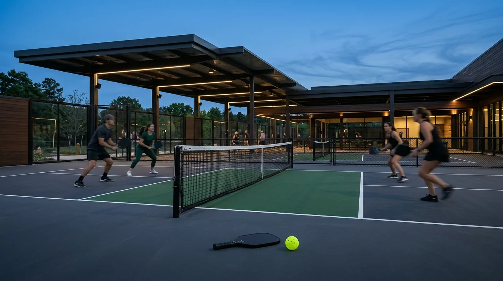
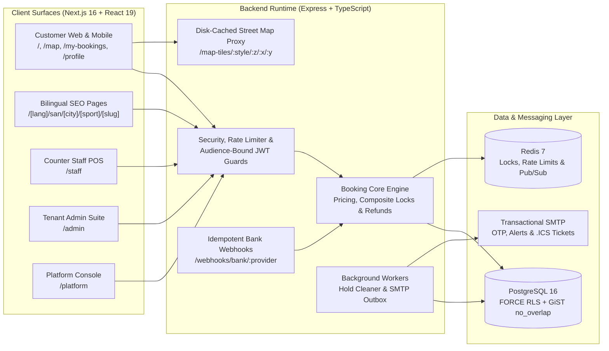
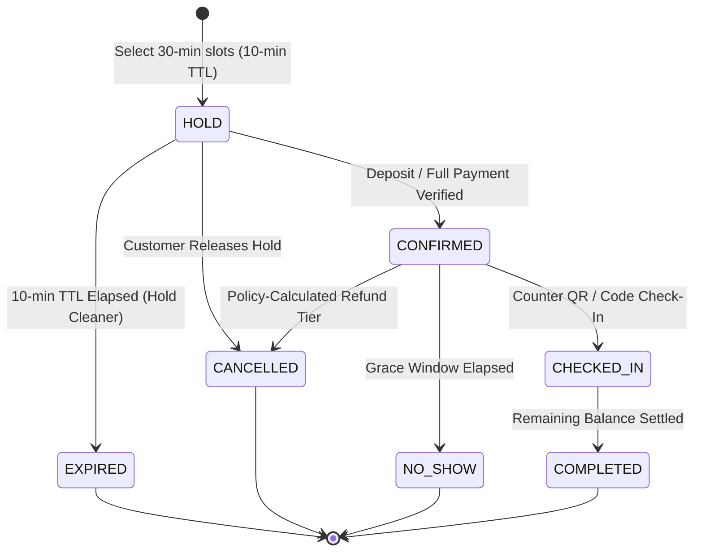

<div align="center">

# Sport BKI — Multi-Tenant Sports Court Booking Platform

**Court reservation, counter POS reconciliation, multi-venue operations, and SaaS tenant governance built on PostgreSQL GiST exclusion constraints and Row-Level Security.**

**Verification, 25 November 2026:** local runtime and selected business/security flows are verified; this is not a production-completion certificate. Read the [current Vietnamese review](docs/REVIEW_2026-11-25_VI.md) and [local run guide](docs/LOCAL_RUN_VI.md). Older audit sections describe historical snapshots.

[](https://www.typescriptlang.org/)
[](https://nextjs.org/)
[](https://react.dev/)
[](https://nodejs.org/)
[](https://www.postgresql.org/)
[](https://redis.io/)
[](https://tailwindcss.com/)

[Architecture](#system-architecture) · [Core Guarantees](#core-engineering-guarantees) · [Portals](#four-portal-platform-matrix) · [Repository Layout](#repository-structure) · [Quick Start](#getting-started) · [Verification](#quality-assurance-and-verification)

</div>

---


<table>
  <tr>
    <td width="33.33%">
      
      <br />
      <sub><strong>Composite Turf Engine</strong> — Automatic parent-child conflict expansion between 5-a-side and 7-a-side courts.</sub>
    </td>
    <td width="33.33%">
      
      <br />
      <sub><strong>30-Minute Multi-Slot Toggle</strong> — Independent contiguous and non-contiguous slot selection with 10-minute atomic holds.</sub>
    </td>
    <td width="33.33%">
      
      <br />
      <sub><strong>Multi-Venue SaaS Operations</strong> — Executive occupancy heatmaps, VietQR deposits, shift cash counts, and review moderation.</sub>
    </td>
  </tr>
</table>

---

## Executive Overview

**Sport BKI** is a full-stack, bilingual (`Vietnamese` / `English`) multi-tenant sports facility booking and management platform tailored for mini-football, badminton, pickleball, tennis, basketball, and multi-sport complexes.

Rather than relying on fragile application-layer checks, the platform enforces its critical invariants directly inside **PostgreSQL 16**:
- **Zero Double-Bookings** under concurrent traffic via `btree_gist` range exclusion (`EXCLUDE USING gist`) across physical courts and linked composite court hierarchies.
- **Fail-Closed Tenant Isolation** via `FORCE ROW LEVEL SECURITY` on all tenant-owned tables, queried through a `NOBYPASSRLS` application role scoped per request.
- **Deterministic VND Accounting** using integer-only currency math (`shared/booking.ts`), frozen booking price snapshots, and idempotent payment/refund ledgers.

---

## System Architecture



### Booking & Hold State Machine



---

## Core Engineering Guarantees

| Domain | Architectural Mechanism | Implementation Reference |
| :--- | :--- | :--- |
| **Concurrency & Zero Overlap** | `tstzrange` exclusion constraint (`no_overlap`) on `booking_items` prevents overlapping `HOLD`, `CONFIRMED`, or `CHECKED_IN` intervals at the database kernel level, including composite parent/sub-court expansion (`5A + 5B <-> 7A`). | `migrations/001_initial_schema.sql`<br/>`backend/src/modules/booking/booking.service.ts` |
| **Multi-Tenant RLS Isolation** | Every connection sets transaction-scoped session variables (`app.current_tenant_id`, `app.current_user_id`, `app.current_portal`) on a non-superuser `NOBYPASSRLS` role (`court_app`) and resets state before pool release. | `migrations/004_comprehensive_rls_and_fixes.sql`<br/>`migrations/005_fail_closed_tenant_policies.sql`<br/>`backend/src/config/database.ts` |
| **Portal Token Segregation** | Access tokens enforce strict `aud` claims (`customer`, `staff`, `admin`, `platform`); a customer JWT is rejected at the guard layer on `/api/staff/*`, `/api/admin/*`, and `/api/platform/*`. | `backend/src/common/jwt.ts`<br/>`backend/src/common/auth.guard.ts` |
| **Integer VND Pricing & Snapshots** | Cross-midnight and multi-band slot tariffs (`off-peak`, `prime-time`, `weekend`, `flash-deal`) are computed in exact integer VND and frozen into `price_snapshot` at creation time. | `shared/booking.ts` |
| **Account & OTP Hardening** | Gmail dot/alias canonicalization, E.164 (`+84`) phone normalization, CSPRNG 6-digit OTPs stored strictly as `HMAC-SHA256` digests, and single-use rotating refresh tokens. | `backend/src/modules/customer/auth.routes.ts`<br/>`migrations/007_account_recovery.sql` |
| **Media & Street Tile Pipeline** | Uploaded venue galleries and avatars are sanitized and re-encoded to `WebP` via `sharp`; OpenStreetMap street tiles are proxied and disk-cached by the backend for resilient rendering. | `backend/src/common/uploader.ts`<br/>`backend/src/common/map-tiles.ts` |

> [!IMPORTANT]
> All monetary columns, API payloads, and settlement calculations operate strictly in integer **Vietnamese Dong (`VND`)**. Floating-point arithmetic is never used for deposits, discounts, or shift cash reconciliation.

---

## Four-Portal Platform Matrix

| Surface | Route | Audience | Key Capabilities |
| :--- | :--- | :--- | :--- |
| **Customer Web & Mobile** | `/` | Players & Team Captains | Accent-insensitive search (`unaccent`), dynamic sport filtering, infinite looping WebP venue carousels, independent multi-slot 30-minute calendar toggle, 10-minute holds, VietQR checkout, flash deals, open tournaments, and verified 1–5 star venue reviews. |
| **Dedicated Street Map** | `/map` | Players (Desktop & Mobile) | Standalone interactive Hanoi street map powered by backend-cached OSM tiles, user-initiated Haversine distance (`km`) sorting, sport filters, standard/dark street modes, and one-tap Google Maps routing. |
| **Customer Bookings** | `/my-bookings` | Signed-in Customers | QR check-in pass, pending VietQR resumption, automated policy-based cancellation refund preview, slot rescheduling, and `.ics` calendar export. |
| **Customer Profile** | `/profile` | Signed-in Customers | `320x320` WebP avatar upload, 2-step OTP email change, password rotation, active device session management, JSON personal data export (`C-06`), and account deletion/anonymization. |
| **Bilingual Venue SEO** | `/[lang]/san/[city]/[sport]/[slug]` | Search Engines & Players | Server-rendered `vi`/`en` landing pages with `hreflang`, `Schema.org SportsActivityLocation` JSON-LD, `301` slug history redirects, and `/sitemap.xml`. |
| **Counter Staff POS** | `/staff` | Reception & Cashiers | Shift open/close with physical cash counting and variance tracking, walk-in booking creation, QR/code check-in, `NO_SHOW` marking, balance collection, 4-digit PIN screen lock, and manual court lighting IoT overrides. |
| **Tenant Admin Suite** | `/admin` | Court Owners & Managers | Net revenue & weekday/hour occupancy `%` heatmaps, multi-venue CRUD, single & composite court linking, tariff bands, maintenance blocks, staff RBAC, multi-photo WebP gallery manager, **review moderation & owner replies**, 7-step setup wizard, CSV legacy import, off-peak deals, marketing campaigns, rain closures, and tournaments. |
| **Platform Super Admin** | `/platform` | SaaS Operator | Tenant lifecycle & subscription plans, dynamic sports catalog CRUD, live configurable SMTP settings & delivery test bench, platform-wide showcase media manager, time-boxed 30-minute support sessions, and audit logs. |
| **OpenAPI Explorer** | `http://localhost:4000/docs` | Engineers & Integrators | Interactive Swagger UI covering `/api/customer/v1`, `/api/staff/v1`, `/api/admin/v1`, `/api/platform/v1`, and `/webhooks`. |

---

## Design System & Frontend Craft

The frontend implements a tokenized **Dark Charcoal & Emerald** visual system (`shared/tokens/index.ts` and `frontend/src/app/globals.css`) engineered for high legibility under both indoor arena lighting and outdoor evening glare:

- **Semantic Surface Hierarchy:** Layered charcoal tokens (`#1B1B1F` canvas, `#25252A` elevated cards, `#2E2E35` interactive controls) paired with high-contrast emerald accents (`#00A862` / `#00C070`) and zero raw hex literals inside React components.
- **Typography & Numeric Alignment:** `Be Vietnam Pro` across Latin and Vietnamese diacritics with `font-variant-numeric: tabular-nums` on all prices, countdown timers, occupancy cells, and time-slot headers.
- **Responsive Mobile Ergonomics:** Dedicated mobile bottom navigation dock (`Book`, `Map`, `My Bookings`, `Profile`), touch-swipeable photo carousels, zero horizontal overflow down to `360px` viewports, and snappy `110ms` state transitions.
- **Strict Bilingual Parity:** `shared/i18n/vi.json` and `shared/i18n/en.json` maintain `1:1` structural key parity, verified automatically in CI/QA scripts.

---

## Repository Structure

```text
sport_bki/
├── backend/
│   ├── src/
│   │   ├── common/                 # Portal JWT guards, sharp WebP uploader, SMTP mailer, audit log, OSM tile proxy
│   │   ├── config/                 # Scoped PostgreSQL RLS pool, AsyncLocalStorage context, Redis client
│   │   ├── modules/
│   │   │   ├── booking/            # Core booking service, composite court locks, payment reconciliation
│   │   │   ├── customer/           # Auth, multi-slot holds, profile, deals, SEO & venue reviews routes
│   │   │   ├── staff/              # Counter bookings, shift cash ledger, PIN lock & IoT overrides
│   │   │   ├── admin/              # Venues, courts, analytics, wizard, CSV import, reviews & extensions
│   │   │   ├── platform/           # Super Admin tenants, sports catalog, live SMTP & showcase media
│   │   │   └── webhooks/           # Idempotent bank transfer & email bounce webhooks
│   │   ├── workers/                # 10-minute hold expiration cleaner & transactional email outbox worker
│   │   └── main.ts                 # Express application bootstrap & route mounting
│   ├── package.json
│   └── tsconfig.json
├── frontend/
│   ├── public/images/showcase/     # Optimized WebP stadium, court, community & clubhouse assets
│   ├── src/
│   │   ├── app/                    # Next.js App Router (/, /map, /my-bookings, /profile, /staff, /admin, /platform, SEO)
│   │   ├── components/             # Calendar grid, looping carousel, street map, reviews, VietQR, admin suites
│   │   ├── context/                # Multi-portal AuthContext & VI/EN LanguageContext
│   │   ├── hooks/                  # Accessible dialog & interaction hooks
│   │   └── lib/                    # Typed API client & media URL resolvers
│   ├── next.config.js
│   ├── tailwind.config.js
│   └── package.json
├── shared/
│   ├── booking.ts                  # Pure integer VND slot pricing & cancellation refund calculator
│   ├── i18n/                       # 1:1 Vietnamese (vi.json) and English (en.json) translation catalogs
│   └── tokens/                     # Semantic color, spacing, radius & shadow design tokens
├── init-db/
│   └── 01-init-extensions.sql      # PostgreSQL extensions (uuid-ossp, btree_gist, unaccent, pg_trgm)
├── migrations/                     # Sequential SQL migrations (001_initial_schema .. 013_venue_reviews)
├── qa/                             # Automated pricing, RLS isolation, i18n encoding & E2E verification scripts
├── docs/                           # Product specifications, feature extension briefs & technical audit handoff
├── docker-compose.yml              # PostgreSQL 16 + Redis 7 local infrastructure
└── .env.example                    # Sanitized environment configuration template
```

---

## Getting Started

### Prerequisites

- **Node.js** `20.x` or newer (`npm` `10+`)
- **Docker** & **Docker Compose** (for PostgreSQL `16` and Redis `7`)

### 1. Configure Environment Variables

Copy `.env.example` to `.env` in the repository root (and `backend/.env` if running backend scripts directly) and populate your local credentials:

```bash
cp .env.example .env
```

> [!NOTE]
> Never commit `.env` or `backend/.env`. Keep `AUTH_EMAIL_MODE=local` during local development to inspect OTP codes on loopback without external SMTP credentials, or switch to `AUTH_EMAIL_MODE=smtp` (or configure SMTP live inside `/platform`) for real email delivery.

### 2. Start PostgreSQL 16 and Redis

```bash
docker compose up -d
```

### 3. Apply Database Migrations

Run the SQL migrations in lexical order (`001` through `013`) using the helper runner or `psql`:

```bash
cd backend
npm install
cd ..

node qa/apply-sql.cjs migrations/001_initial_schema.sql
node qa/apply-sql.cjs migrations/002_seed_initial_data.sql
node qa/apply-sql.cjs migrations/003_repair_demo_encoding.sql
node qa/apply-sql.cjs migrations/004_comprehensive_rls_and_fixes.sql
node qa/apply-sql.cjs migrations/005_fail_closed_tenant_policies.sql
node qa/apply-sql.cjs migrations/006_remove_unverified_demo_bank.sql
node qa/apply-sql.cjs migrations/007_account_recovery.sql
node qa/apply-sql.cjs migrations/008_complete_booking_core_and_features.sql
node qa/apply-sql.cjs migrations/009_user_profiles_geo_and_analytics.sql
node qa/apply-sql.cjs migrations/010_dynamic_sports_and_platform_crud.sql
node qa/apply-sql.cjs migrations/011_venue_galleries_and_system_media.sql
node qa/apply-sql.cjs migrations/012_flexible_multi_slot_booking.sql
node qa/apply-sql.cjs migrations/013_venue_reviews_and_moderation.sql
```

### 4. Build and Run Backend API (`:4000`)

```bash
cd backend
npm run build
npm run start
```

Verify service health at `http://localhost:4000/health` and interactive OpenAPI documentation at `http://localhost:4000/docs`.

### 5. Build and Run Frontend Application (`:3000`)

```bash
cd frontend
npm install
npm run build
npm run start
```

Open `http://localhost:3000` in your browser (for rapid iterative UI development, run `npm run dev` instead).

---

## Quality Assurance and Verification

The `qa/` directory contains deterministic verification scripts covering financial math, multi-tenant Row-Level Security, UTF-8/i18n integrity, and end-to-end portal flows:

```bash
# Verify integer VND cross-band slot pricing & cancellation refund tiers
node qa/pricing-check.cjs

# Verify PostgreSQL FORCE ROW LEVEL SECURITY isolation across tenants & customers
node qa/rls-regression.cjs

# Verify 1:1 VI/EN translation key parity, font coverage & database UTF-8 integrity
node qa/audit-fonts-i18n-encoding.cjs

# Run full-stack API & portal regression suite (cleans up all test fixtures on exit)
node qa/comprehensive-full-suite.cjs
```

> [!TIP]
> To populate realistic demo bookings, settled payments, and an open friendly tournament for previewing the `/admin` executive revenue charts and occupancy heatmaps locally, run `node qa/seed-local-demo-activity.cjs`.

---

## Documentation Index

- [Master System Specification (`court-booking-system-spec-en.md`)](court-booking-system-spec-en.md) — Domain rules, state machines, RLS model, edge cases, and acceptance criteria.
- [Feature Extensions Brief (`docs/feature-extensions-brief.md`)](docs/feature-extensions-brief.md) — Specifications for setup wizard, CSV import, flash deals, SEO, campaigns, rain closures, tournaments, and IoT lighting.
- [UI Redesign Brief (`docs/ui-redesign-brief-en.md`)](docs/ui-redesign-brief-en.md) — Dark Charcoal & Emerald design tokens, typography, and responsive layout standards.
- [Implementation Audit & Handoff (`docs/IMPLEMENTATION_AUDIT_AND_AI_HANDOFF_EN.md`)](docs/IMPLEMENTATION_AUDIT_AND_AI_HANDOFF_EN.md) — End-to-end architectural audit and Phase 2/3 product roadmap.
