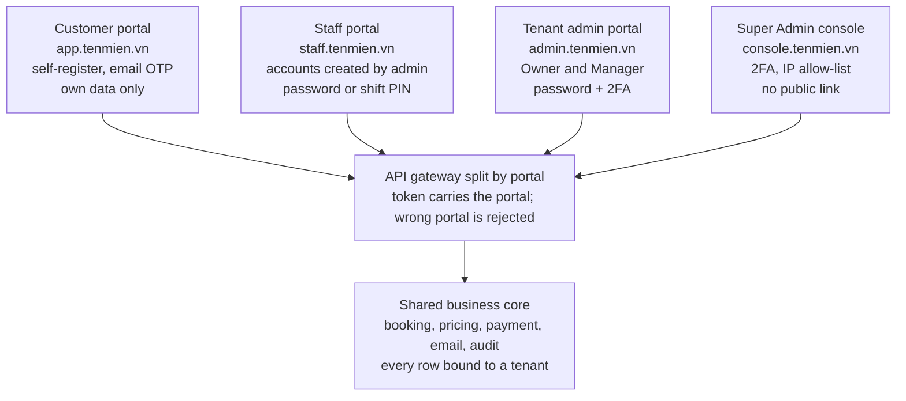

# Sports Court Booking Platform: System Specification

## 0. How to read this document (for AI agents and engineers)

### 0.1 Purpose

This document specifies a multi-tenant SaaS platform for booking sports courts (mini football, badminton, pickleball, tennis, basketball, billiards, karaoke, game rooms). It covers four account groups with four separate login portals, the booking flows, the data model, payments, email notifications, security, QA test cases, a feature catalog by phase, an API list and a data structure summary.

### 0.2 Conventions

- **MUST, MUST NOT, SHOULD, MAY** follow RFC 2119 meaning.
- **P1, P2, P3** are release phases. P1 is required for the first sellable release. P2 is expansion. P3 is growth.
- Values marked **(proposed)** are defaults chosen by the author. They can be tuned. They are not legal or vendor facts.
- Identifiers, column names, endpoints and enum values are written in `code font`.
- Feature IDs (`C-`, `S-`, `A-`, `P-` prefixes), test IDs (`REG-`, `OTP-`, `FGT-`, `LOG-`, `BKG-`, `PRM-`, `PRT-`, `STF-`, `UI-`) and decision IDs (`D-`) are stable references.

### 0.3 Rules for AI agents that implement this specification

1. Implement **P1 first**. Do not implement P2 or P3 items unless the human asks.
2. All **user-facing text** (screens, emails, errors, notifications) MUST be in **Vietnamese**. Code, identifiers, comments, logs and commit messages MUST be in English. Use an i18n layer so English can be added later (P3).
3. Do **not invent** vendors, prices, legal claims or limits that this document does not state. Where the text says "verify", ask the human.
4. Where a decision is open, apply the **default in 0.4** and write the assumption in your answer.
5. Never hard-code secrets. Never log OTP codes, passwords, tokens or full card or bank data.
6. Enforce permissions **on the server** for every endpoint. The user interface is never the security boundary.
7. Enforce tenant isolation in every query and with PostgreSQL Row-Level Security.
8. Anything that touches money or the booking calendar MUST write an audit log entry.
9. Section 19 to 25 are the final word if they differ from earlier text. Earlier sections were reconciled with them in this edition.

### 0.4 Default decisions (apply unless the human overrides)

| ID | Decision | Default | Alternative |
|---|---|---|---|
| D-01 | Meaning of "Admin" | Admin = tenant admin (Owner, Manager). The human operator of the platform = Super Admin | Merge both groups into one |
| D-02 | Email policy at registration | Accept any valid email (Gmail recommended) | Config flag to allow only `@gmail.com` |
| D-03 | OTP format | 6 digits | 6 characters from a 31-character alphabet (A-Z and 0-9 without `0`, `O`, `1`, `I`, `L`) |
| D-04 | Phone verification | At the first booking, by SMS or Zalo | At registration |
| D-05 | Owner and Manager use the staff portal (counter mode) | Enabled, config flag `allow_admin_in_staff_portal` | Disabled |
| D-06 | Staff PIN quick unlock | Enabled | Password only |
| D-07 | First sport and launch area | Not decided; ask the human | n/a |
| D-08 | Primary domain | Placeholder `tenmien.vn`; ask the human | n/a |
| D-09 | Build approach (self-code, hire, AI-assisted) and budget | Not decided; ask the human | n/a |

### 0.5 Glossary

| Term | Meaning |
|---|---|
| Tenant | One court-owning business (the paying customer of the platform) |
| Venue | One physical site of a tenant |
| Court | One bookable court inside a venue, bound to one sport |
| Court link | Composite relation: a large court made of smaller courts (for example one 7-a-side pitch = two 5-a-side pitches) |
| Booking | A reservation of one or more courts for a time range |
| Hold | Temporary reservation (`PENDING`) with an expiry while payment is awaited |
| Block | A booking of type `BLOCK` that closes a court (maintenance, tournament) |
| Series | A recurring weekly reservation that generates individual bookings |
| Portal | A separate entry point (web address, login screen, session and API group) |
| Shift | A staff work period with opening and closing cash |
| SĐT | Vietnamese abbreviation for phone number (`số điện thoại`) |
| VietQR | Vietnamese standard QR code for bank transfers |
| Zalo, ZNS | Zalo is a Vietnamese messenger. ZNS is its paid template notification service |
| OTP | One-time password |
| CRM | Customer relationship records kept by a tenant |
| RLS | PostgreSQL Row-Level Security |
| IDOR | Insecure direct object reference (reading another user's record by changing an ID) |
| CSPRNG | Cryptographically secure random number generator |
| HMAC | Keyed hash used to store OTP codes |

---

## 1. Overview and design principles

The product is a **multi-tenant SaaS**. Hierarchy: **tenant** (court owner) → **venue** (site) → **court** (one sport each).

Five principles apply everywhere:

1. **One data core, four entry points.** Customer app, staff portal, tenant admin portal, Super Admin console. One API, authorization checked on the server.
2. **Never double-book.** The no-overlap rule is enforced in the database, not only in code.
3. **Money goes straight to the court owner's bank account** in the early phases. The platform only charges a subscription fee. This avoids the legal risk of holding other people's money.
4. **A court owner can use it on a phone after 5 minutes**, with no training.
5. **Every action on money or the calendar is written to an audit log.**

---

## 2. Roles and permissions

### 2.1 Roles

| Role | Account group | Who | Data scope |
|---|---|---|---|
| Super Admin | Platform | Platform operator (the product owner and team) | Whole platform. Tenant data only in support mode, with logging |
| Owner | Tenant admin | Court owner | All venues of the tenant |
| Manager | Tenant admin | Venue manager | Assigned venues |
| Staff | Staff | Cashier, front desk | Assigned venue(s), daily operations |
| Customer | Customer | Person who books | Own data only |
| Guest | none | Not logged in | Public venue info, prices, availability |

### 2.2 Permission matrix (SA = Super Admin)

| Function | SA | Owner | Manager | Staff | Customer |
|---|---|---|---|---|---|
| View availability | yes | yes | yes | yes | yes |
| Book online | no | no | no | no | yes |
| Create booking at the counter | no | yes | yes | yes | no |
| Confirm payment manually | no | yes | yes | yes | no |
| Cancel or change a booking | no | yes | yes | per policy | own, per policy |
| Manual discount or refund | no | yes | within limit | no | no |
| Edit courts, prices, policies | no | yes | yes | no | no |
| Manage staff accounts | no | yes | staff only | no | no |
| View revenue reports | no | yes | yes | own shift only | no |
| Manage tenants, plans, lock accounts | yes | no | no | no | no |

No role can read another tenant's data.

### 2.3 Account separation rules (reconciled)

- There are **four account groups with four login portals** (Section 19). Accounts are stored in separate tables.
- Customers log in with email, username or phone number plus password (Section 16). Staff and admins log in only at their own portals.
- Owner and Super Admin MUST use two-factor authentication (2FA).
- Every table with tenant data has `tenant_id`. Every query filters by it. PostgreSQL RLS is the second layer.
- Super Admin sees tenant data only through a time-limited **support session**. Every access is logged.
- Authorization is checked by role **and** by scope (right tenant, right venue, right owner of the record). The most common bug is customer A reading customer B's booking by changing an ID in the URL. This MUST be tested (`PRM-01`).

---

## 3. Business flows

### 3.1 Booking lifecycle

`PENDING` (hold, waiting for deposit) → `CONFIRMED` → `CHECKED_IN` → `COMPLETED`

Side branches: `EXPIRED` (hold ran out), `CANCELLED`, `NO_SHOW`.

Only `PENDING` (not expired), `CONFIRMED`, `CHECKED_IN` and `COMPLETED` occupy the calendar.

### 3.2 Customer books online

1. Choose sport, venue and date. Show the hourly grid (free slots, booked slots, price per slot).
2. Choose one or more adjacent slots. The system creates a `PENDING` booking, **holds the slot for 10 minutes** (configurable) and **freezes the price** at this moment.
3. Enter name and phone. Verify OTP on the first time.
4. Show a **VietQR** code with the deposit amount and a unique transfer note (the booking code).
5. The bank notifies the system by webhook. The system matches the code and amount, sets `CONFIRMED`, and notifies the customer and the court owner.
6. If unpaid after the hold time, set `EXPIRED` and release the slot.

The court owner can choose a mode: deposit required, no deposit, or manual approval per booking.

### 3.3 Counter or phone booking

Staff creates the booking, picks an existing customer or creates one quickly by phone number, and records cash or bank transfer. This flow is **required**, because most court owners still take bookings by Zalo and phone. If the system only supported online booking, its calendar would drift from reality.

### 3.4 Cancel, reschedule, refund

- Cancellation policy is configurable per venue. Example (proposed): cancel 24 hours or more before start refunds 100% of the deposit; 12 to 24 hours refunds 50%; under 12 hours forfeits the deposit.
- **A reschedule creates a new booking linked to the old one.** It never edits in place, so money reconciliation stays clear.
- In early phases the court owner refunds by hand. The system records the refund and its status.

### 3.5 Arrival and remaining payment

Staff scans the booking QR code or searches by phone, taps check-in, collects the remaining amount plus extra services (drinks, shoe rental, bibs), then sets `COMPLETED`.

### 3.6 No-show

After start time plus X minutes (configurable), staff marks `NO_SHOW`. The deposit is kept. The system counts no-shows per customer. Above a threshold it requires a 100% deposit or blocks online booking.

### 3.7 Weekly recurring booking

Create a **series**. The system generates concrete bookings for the next 8 weeks and keeps generating on a rolling basis. A single session can be skipped. A clash with a blocked day or holiday MUST be reported to the court owner for handling. The system MUST NOT cancel silently.

### 3.8 Court block (maintenance, tournament)

The owner creates a **block** that occupies the calendar. If it overlaps existing bookings, the system forces the owner to handle each booking (reschedule or cancel with notification) before the block is accepted.

### 3.9 Shift close and reconciliation

At the end of a shift, staff closes cash and transfer totals. The owner sees differences between the system and the real count. This feature shows clear value because it prevents loss.

---

## 4. Feature summary by phase

The full catalog with IDs is in Section 22. This is the summary.

**Phase 1 (required, sellable MVP)**
- Customer: browse courts, prices and availability; book; register and log in; email OTP; forgot password; pay deposit with VietQR; view and cancel own bookings; email confirmation.
- Tenant admin and staff: manage venues, courts, opening hours; price table by time band and weekday, weekend, holiday; grid calendar by court; create, edit, cancel, check-in booking; record payments; block courts; basic customers; revenue report by day, week, month; roles Owner, Manager, Staff; audit log.
- Super Admin: manage tenants, subscription plans, lock and unlock accounts, monitoring.
- Infrastructure: database-level overlap prevention, expiring holds, idempotent payment webhook, automatic backups.

**Phase 2 (expansion)**
- Weekly recurring bookings, composite courts, shift close and reconciliation.
- Reminders by Zalo ZNS or SMS, push notifications.
- Extra services (drinks, rentals), receipts.
- Membership cards, prepaid hour packs, vouchers, loyalty points.
- Waiting list when slots are full, automatic notice on cancellation.
- Separate native apps for customers and for managers.

**Phase 3 (growth)**
- Multiple venues in one account and cross-venue reports.
- Matchmaking, opponent search, internal tournaments and rankings.
- Court reviews, public venue pages with SEO, Google Maps integration.
- Dynamic pricing by occupancy, e-invoice integration, automatic light and gate control.
- Payment gateways (VNPay, MoMo, ZaloPay) and a marketplace.

---

## 5. Technical architecture (proposed)

Use a **modular monolith**. Do not split into microservices in the early phase; it only adds operating cost.

| Component | Proposal | Reason |
|---|---|---|
| Customer web and admin web | Next.js + TypeScript | One codebase, SEO for public pages, mobile friendly |
| Backend API | NestJS (TypeScript). Laravel is acceptable if the team knows PHP | Clear module structure, easy to hire for |
| Database | PostgreSQL | Exclusion constraints for overlap prevention, RLS, strong time types |
| Cache and queue | Redis + BullMQ | Holds, expiry, background notifications |
| Mobile | PWA first; React Native (Expo) later | Fast market test, reuse TypeScript |
| Realtime calendar | SSE or WebSocket, or polling every 10 to 15 seconds | Several people watch one grid |
| Infrastructure | VPS near Vietnam, Docker, Nginx, Cloudflare | One VPS with 2 to 4 vCPU should handle tens to hundreds of courts |
| Monitoring | Sentry, uptime monitor, central logs | Know about errors before the court owner calls |

**Native apps (P2):** build **two separate apps**: the Customer app (booking) and the Management app (calendar, check-in, payments, new-booking alerts). The Management app has **two separate login screens**, one for Staff and one for Admin, and a different interface after login for each role. In P1, a PWA for both is enough to test the market.

**Portals and API groups** are specified in Section 19 and Section 24.

---

## 6. Data design

### 6.1 Main entities

`tenants`, `venues`, `sports`, `courts`, `court_links` (composite courts), `opening_hours`, `price_rules`, `staff_users` (see `tenant_staff` in Section 20), `customers`, `bookings`, `booking_courts`, `booking_items` (frozen price per slot and services), `payments`, `refunds`, `booking_series`, `notifications`, `audit_logs`, `subscriptions`. The complete list with columns is in Section 25.

### 6.2 Design decisions

- **Time:** store `timestamptz` (UTC). Display in the venue time zone (`Asia/Ho_Chi_Minh`). Grid step is 30 minutes (configurable per sport). A venue open past midnight (karaoke, billiards) needs a **business day** concept.
- **Money:** integer VND. Never floating point.
- **Frozen price:** copy the price into `booking_items` when booking. Changing the price table later MUST NOT change old bookings.
- **Blocks, maintenance, tournaments:** store in the **same table as bookings** with `type = BLOCK`, so one overlap constraint covers everything.
- **Composite courts:** one booking can occupy several physical courts (7-a-side = 5A + 5B). Put the constraint on `booking_courts`, one row per physical court occupied.

### 6.3 Overlap prevention in PostgreSQL

```sql
CREATE EXTENSION IF NOT EXISTS btree_gist;

ALTER TABLE booking_courts
  ADD CONSTRAINT no_overlap
  EXCLUDE USING gist (
    court_id WITH =,
    tstzrange(start_at, end_at, '[)') WITH &&
  ) WHERE (active);
```

`active` is set to `false` when a booking expires, is cancelled or is a no-show. If two people book at the same moment, the database guarantees one succeeds and the other gets an error and a suggestion for another slot.

Also: a background job every minute moves expired `PENDING` rows to `EXPIRED`. Before inserting a new booking, clean expired `PENDING` rows for that court.

### 6.4 Price rules

A rule has: scope (court type or a specific court), weekday, time band, price, validity period, priority. A holiday rule overrides a normal rule. A booking that spans several price bands sums the price slot by slot.

---

## 7. Payments and reconciliation

- **Each tenant configures its own bank account.** The system generates a VietQR for that account with the amount and a unique transfer note (the booking code).
- **Receive transfer signals** through a bank webhook service (examples: SePay, Casso, payOS) or a bank API. Verify current terms, fees and supported banks before choosing a provider.
- **The webhook MUST be idempotent.** The same transaction delivered twice is recorded once. Always verify the webhook signature or key. Store `event_id` as unique.
- **Mismatch cases MUST have a defined handling:**
  - Wrong amount or wrong note: put the payment in a "needs manual handling" queue for the owner.
  - Money arrives after the hold expired: if the slot is still free, confirm again automatically. If someone else already took it, notify the owner to refund.
  - Customer pays too much or too little: record the difference on the payment.
- **Later phases:** add payment gateways (VNPay, MoMo, ZaloPay). Think carefully about payment-intermediary obligations before holding money for owners.

---

## 8. Notifications

| Channel | Used for | Notes |
|---|---|---|
| Email | OTP, booking confirmation, receipt, reports | **Required channel.** Sent through a transactional email service (Section 17) |
| Push (FCM/APNs) | New bookings, reminders | Free, needs an app |
| Zalo ZNS | Confirmation and reminders to customers | Message templates must be approved; charged per message |
| SMS (brandname) | OTP fallback, backup | Costs money; brandname registration needed |

Provide a **fallback** (if Zalo fails then SMS) and a retry queue. The court owner always receives new-booking alerts immediately.

---

## 9. Screen list

Login screens differ per portal (Section 19.3). After login, each portal shows a different interface.

**Customer (web and app):** home and court search; venue detail; booking grid; confirm and pay by QR; register; log in; OTP entry; forgot password; reset password; booking history; booking detail (check-in QR, cancel, reschedule); profile.

**Staff portal:** staff login; first-time password change; choose venue and shift; open shift; today dashboard; court grid calendar; quick booking; booking detail (check-in, collect payment, cancel, change); payments needing handling; sell services; customer lookup; shift (open, close, history); handover notes; notifications; profile, password and PIN.

**Tenant admin portal:** admin login; 2FA entry and setup; accept invitation; today dashboard; calendar grid; booking detail; payments needing handling; customers; courts and price table; cancellation and deposit policies; staff and permissions; shift close; reports; notification and bank account settings.

**Super Admin console:** console login; 2FA; tenant list; plans and renewals; system status; support log; notification template settings; platform reports.

---

## 10. Security and legal

- Hash passwords with Argon2id (or bcrypt). Short-lived JWT access tokens with refresh tokens. Rate limit OTP and login. HTTPS required.
- Check permissions on **every API** by role, tenant and record ownership (prevent IDOR).
- Encrypt sensitive data. Back up automatically every day and **test restores regularly**.
- **Personal data:** follow Vietnam's Decree 13/2023/ND-CP on personal data protection: provide terms, collect consent, let customers request deletion.
- If the platform later becomes a connecting marketplace that earns commission, review obligations for e-commerce platforms and payment intermediaries. Ask a lawyer or accountant first. This document is not legal advice.

---

## 11. Screening: real-world situations that break booking systems

| Situation | Handling |
|---|---|
| Two customers press book for the same slot | Database exclusion constraint. The later one gets a message and a nearby slot suggestion |
| Customer pays after hold expiry | See Section 7: confirm again if free, otherwise refund |
| Bank webhook arrives twice or late | Idempotency by transaction ID; manual-handling queue |
| Network loss at the counter | UI shows state clearly. Never pretend an action succeeded |
| Staff deletes a paid booking to pocket money | No hard delete. Cancel only with reason, audit log, shift variance report |
| Owner changes price table when bookings exist | Frozen prices in `booking_items` do not change |
| Outdoor court and rain | Bulk "weather reschedule" function, refund or keep deposit as credit |
| Booking spans several price bands | Sum per slot |
| Odd durations (60, 90, 120 minutes) | Minimum duration and step configurable per sport |
| 7-a-side and 5-a-side share the pitch | Composite court table. Booking the 7-a-side blocks both 5-a-side courts |
| Booking on behalf of someone else | Separate "booker" and "player". The booker's phone receives notices |
| Customers often cancel late or no-show | Count violations, raise deposit, block online booking above a threshold |
| Recurring booking meets a holiday or maintenance | Notify the owner to handle each session. No silent cancel |
| Opening hours change on holidays | Per-day exception overrides standard hours |
| User under 18 | Collect minimal data. Terms explain guardian responsibility where needed |
| Owner stops using the service | Data export (CSV), controlled tenant lock, keep data for the announced period |
| Weekend traffic spike | Cache the grid, load test beforehand, watch the 17:00 to 21:00 peak |

---

## 12. Testing and operations (summary)

The full QA plan with test cases is Section 18 and Section 23.3. Summary:

- **Concurrency test:** 50 simultaneous requests for one slot, exactly one booking succeeds.
- **Payment test:** duplicate webhook, underpayment, overpayment, late arrival, wrong note.
- **Permission test:** each role calls APIs of higher roles and of other tenants; customer A tries to read customer B's booking.
- **Time test:** midnight boundaries, day rollover, bookings past midnight.
- **Load test:** simulate weekend peak.
- **Pilot:** run in parallel with the paper notebook at 1 to 2 courts for 2 weeks before charging.

---

## 13. Roadmap and cost (reference)

| Phase | Content | Estimated time* |
|---|---|---|
| 0 | Survey 5 to 10 court owners, choose the first sport, design screens and design tokens | 1 to 2 weeks |
| 1 | MVP (Section 4 and Section 22, items marked P1) on web or PWA, free pilot at 1 to 2 courts | 10 to 14 weeks (includes four login portals, staff accounts, email notifications) |
| 2 | Fix by feedback, reminders, recurring bookings, start charging | 4 to 8 weeks |
| 3 | Native apps, composite courts, membership cards, wider customer acquisition | 2 to 4 months |

*Rough estimate for 1 to 2 experienced developers. Real time depends on skill and UI polish.

**Monthly running costs (verify current prices):** VPS, domain, bank webhook service, Zalo ZNS or SMS messages, error monitoring, Apple and Google developer accounts for native apps.

**Revenue model:** subscription per venue (about 200,000 to 500,000 VND per month is an acceptable level, proposed), one-time setup fee, higher plan with automatic reminders and deep reports.

---

## 14. Go-live checklist

- [ ] 50 concurrent requests to one slot tested
- [ ] Payment webhook is idempotent and signature verified
- [ ] Every role tested for permissions including cross-tenant access
- [ ] Expired holds release automatically and never freeze the calendar
- [ ] Automatic backup configured and a restore tested
- [ ] Audit log covers cancel, refund, discount, price edit
- [ ] Terms of use and personal data policy published
- [ ] Owner interface works on an old phone and a small screen
- [ ] Support channel (Zalo) and a weekend incident process exist
- [ ] Ran in parallel with the paper notebook for at least 2 weeks

---

## 15. Next steps

Decisions the human must make are listed in Section 23.5 (with defaults in Section 0.4). Documents that can be produced next: detailed ERD, expanded API contract, per-screen wireframes, project structure and bootstrap commands.

---

## 16. Accounts and authentication

This section replaces any earlier rule that customers log in by phone OTP.

### 16.1 Customer registration

| Field | Validation | Notes |
|---|---|---|
| Email (Gmail) | Valid format, max 254 characters, trim and lowercase, unique | Gmail is recommended but any valid email is accepted by default (D-02). For Gmail, normalize by removing dots and any `+alias` when checking uniqueness, so one mailbox cannot create many accounts. Keep the original address for sending |
| Phone (SĐT) | Vietnamese mobile number, normalize to `+84...`, unique | Use libphonenumber. Accept `09xxxxxxxx`, `+849xxxxxxxx`, `849xxxxxxxx` as the same number |
| Username | 4 to 20 characters from `a-z`, `0-9`, `.`, `_`; must not start or end with `.` or `_`; case-insensitive; reserved words blocked (`admin`, `root`, `support`, `owner`, `system`, ...) | Stored lowercase |
| Password | 8 to 128 characters (10 or more recommended); must not contain username, email or phone; must not be a common or breached password | Follow NIST SP 800-63B: prefer length over complex character rules. Allow paste, show/hide button, strength meter. Hash with Argon2id |
| Re-enter password | Must equal password | Validate on client **and** on server |
| Accept terms | Required | Store terms version and timestamp |

**Registration flow**

1. The customer fills the form. The UI shows instant errors (duplicate username or email, password mismatch).
2. The server re-validates everything, creates the account as `PENDING_VERIFICATION` and sends a one-time code to the email.
3. The customer enters the OTP within 10 minutes, the email is verified, status becomes `ACTIVE`, the user is logged in and a welcome email is sent.
4. Until the email is verified the customer cannot book. Accounts not verified after 48 hours are cleaned up and the email is released.
5. Phone number is verified by SMS or Zalo **at the first booking** or when risk signals appear (D-04). This saves message cost.

**Account statuses:** `PENDING_VERIFICATION`, `ACTIVE`, `LOCKED` (temporary, wrong passwords), `SUSPENDED` (by admin), `DELETED` (anonymized on request).

**Duplicate email or phone message.** A clear message ("already used, log in or reset password?") is friendly but lets attackers probe whether an email has an account. Balance: keep the clear message, add rate limits and captcha on mass probing.

### 16.2 Login

- Identifier: **email, username or phone** plus password.
- On failure show only "Account or password is incorrect". Never reveal which part is wrong.
- 3 failures show a captcha. 5 failures lock for 15 minutes (per account and per IP), then 30 and 60 minutes on repeat, and email the account owner.
- Login from a new device sends a warning email.
- Access token lives 15 minutes. Refresh tokens rotate. Provide "log out of all devices".
- **Staff and tenant admins do not self-register.** Tenant admins are invited by email (single-use link, expires in 48 hours). Staff can be given an account by phone number and a temporary password (Section 20). Owner and Super Admin MUST use TOTP 2FA. Staff, tenant admins and Super Admin each have their own login portal (Section 19).
- Later: log in with Google or Zalo.

### 16.3 Forgot password with an email OTP

1. The customer taps "Forgot password" and enters email or username.
2. The system **always** shows a neutral message: "If the account exists, a verification code was sent to the registered email." This does not reveal whether the email exists.
3. If the account exists, send a **6-character OTP** to the registered email. The email states the code, validity (10 minutes), time and device of the request, and a warning "if this was not you, ignore this email".
4. The correct OTP yields a single-use **reset token**, valid for 15 minutes.
5. The customer enters the new password and re-enters it. Same rules as registration. It MUST NOT equal the current password or a few recent ones.
6. On success: revoke all sessions, invalidate all other OTPs, and **send the email "Your password was changed"** with time, device and a "This was not me" button (locks the account and starts recovery).
7. When logged in, changing the password requires the old password. Changing email or phone sends a notice to the **old email** and an OTP to the new email.

**If the customer lost access to the email:** manual recovery through support, verified by the registered phone and booking history. Owners and Super Admins have no shortcut: identity is verified directly by another Super Admin.

### 16.4 OTP specification

| Property | Rule |
|---|---|
| Length and characters | **Default 6 digits** (easy on phones, 1,000,000 combinations). For "6 letters and digits", use a 31-character alphabet without `0`, `O`, `1`, `I`, `L`, about 887 million combinations (D-03) |
| Generation | Cryptographically secure random generator (CSPRNG). Never a normal random function |
| Storage | Store only a keyed hash (HMAC), never the plain code. Store purpose, user, expiry, attempt count |
| Validity | 10 minutes, single use |
| Wrong entries | Max 5 per code, then the code is cancelled and a new one is required. With 6 digits and 5 tries, the chance of guessing is at most 5 in 1,000,000 |
| Resend | At least 60 seconds apart; max 5 codes per hour and 10 per day per email; limits per IP too; a new code invalidates the old one |
| Purpose binding | A registration code cannot be used to reset a password and vice versa |
| Other security | Constant-time comparison; never write the code to logs, URLs or analytics |
| Test environments | Use a fake mailbox (for example Mailpit) in staging. **Never enable a fixed code like 123456 in production** |

### 16.5 Data model additions

- **users (customer_accounts):** id, username (lowercase), email, email_normalized, email_verified_at, phone_e164, phone_verified_at, password_hash, status, failed_login_count, locked_until, terms_version, created_at.
- **otp_codes:** id, user_id, purpose (`REGISTER`, `RESET_PASSWORD`, `CHANGE_EMAIL`), code_hash, expires_at, attempts, used_at, created_at.
- **refresh_tokens:** id, user_id, token_hash, device_info, ip, expires_at, revoked_at.
- **login_events:** user_id, result, ip, device, time (for new-device alerts and investigation).
- **Unique indexes** on username (lowercase), email_normalized, phone_e164, applied to non-deleted accounts only. This is the last defence when two people register at the same moment.

### 16.6 Decisions (defaults in Section 0.4)

1. Gmail only or any email (default: any email).
2. 6 digits or 6 letters and digits (default: 6 digits).
3. Verify phone at registration or at first booking (default: first booking).

---

## 17. Email notifications

### 17.1 Principles

- **Do not send through a personal Gmail account over SMTP.** Limits are low, it is easily blocked and unreliable at scale. Use a transactional email service (for example Amazon SES, SendGrid, Mailgun, Resend, Brevo; verify current prices and terms) and send from **your own domain**, for example `no-reply@tenmien.vn`.
- **Configure SPF, DKIM and DMARC** for the domain so mail lands in the inbox, not spam. This is practically required for Gmail.
- **Send through a queue (outbox):** write the send request in the same transaction that saves the booking. A worker sends after commit. Retry with backoff, record status and the provider message ID.
- **Email is a notification, the system is the source of truth.** A failed email MUST NOT break a booking. The booking still shows fully on web and app.
- **Prevent duplicate sends:** use a key made of booking, template and event version, so a payment webhook delivered twice does not send two emails.
- **Handle bounces and complaints:** receive provider webhooks, mark permanently failed addresses, stop sending and ask the customer to update the email.
- **Always include a plain-text part** next to HTML. The layout MUST be responsive and readable with images blocked and in dark mode.
- **Never send passwords** in email. Never embed long-lived tokens in links. Action links (cancel, reschedule) require login or use a signed, expiring token.
- Escape all user-provided data (names, notes) in templates to prevent HTML or header injection.
- Separate transactional email from marketing email. Marketing email MUST have an unsubscribe link.

### 17.2 Booking confirmation email: mandatory content

| Group | Information |
|---|---|
| Code and status | Booking code, status (Confirmed or Awaiting payment), check-in QR code |
| Venue | Venue name, **full address**, Google Maps link, phone or Zalo contact |
| Court | Court name, court type and sport (for example 5-a-side, court 2) |
| Time | **Weekday, day/month/year, start to end time**, duration, explicit Vietnam time zone (GMT+7) |
| Booker | Full name, phone number (partially masked) |
| Cost | Price per time band, extra services, total, **deposit paid**, **amount due at the venue**, transaction code |
| Policy | Cancellation policy with **concrete deadlines** (for example "cancel before 18:00 on 20/11 for a 100% deposit refund") |
| Actions | Buttons: View booking, Cancel or Reschedule, Directions, **Add to calendar (.ics file)** |
| Notes | Arrive 10 minutes early, bring the QR code, how to contact support, and the sentence "We never ask for your password by email" |

**Sample template (plain text). This is product copy, so it stays in Vietnamese:**

```text
Tiêu đề: [Đã xác nhận] Sân 5 - số 2, 19:00 Thứ Bảy 21/11/2026 (Mã DS-7K3M9Q)

Xin chào {{ten_khach}},
Đặt sân của bạn đã được xác nhận.

Mã đặt sân : DS-7K3M9Q
Cơ sở      : {{ten_co_so}}
Địa chỉ    : {{dia_chi_day_du}}  (Bản đồ: {{link_maps}})
Sân        : Sân số 2 - Sân 5 người
Thời gian  : Thứ Bảy, 21/11/2026, 19:00 - 20:30 (90 phút, GMT+7)

Chi phí
- 19:00-20:00 x 1 giờ ..... 350.000đ
- 20:00-20:30 x 0,5 giờ ... 200.000đ
- Thuê áo bib ............. 30.000đ
Tổng cộng ................ 580.000đ
Đã đặt cọc ............... 200.000đ (mã GD: {{ma_giao_dich}})
Còn phải trả tại sân ..... 380.000đ

Chính sách hủy: Hủy trước 19:00 ngày 20/11/2026 để hoàn 100% tiền cọc.

[Xem booking]  [Đổi lịch / Hủy]  [Chỉ đường]  [Thêm vào lịch]

Liên hệ cơ sở: {{sdt_co_so}}
Vui lòng đến trước 10 phút và đưa mã QR cho nhân viên.
```

The numbers in the sample are illustrations only. Template variables use `{{double_braces}}`.

### 17.3 Email catalog

| # | Event | Recipient | Main content |
|---|---|---|---|
| 1 | Registration, verification needed | Customer | Email verification OTP, valid 10 minutes |
| 2 | Verification succeeded | Customer | Welcome, how to book the first court |
| 3 | Forgot password | Customer, staff | Password reset OTP, time and device of request |
| 4 | Password changed | Registered email | Time, device, "This was not me" button |
| 5 | Login from new device | Account owner | Device, approximate location, what to do if not them |
| 6 | Temporary lock after wrong passwords | Account owner | Reason, unlock time, suggest password reset |
| 7 | Email or phone changed | Old and new email | Change notice, OTP to verify the new email |
| 8 | Slot held, awaiting payment | Customer | Payment deadline, transfer QR code |
| 9 | Booking confirmed | Customer | Full content of Section 17.2 |
| 10 | Payment receipt | Customer | Amount, transaction code, remaining balance |
| 11 | Reminder (24 hours and 2 hours before) | Customer | Summary, directions, refund deadline |
| 12 | Booking cancelled | Customer | Who cancelled, refund amount per policy |
| 13 | Booking rescheduled | Customer | Old time and new time |
| 14 | Owner cancels or blocks a court | Customer | Reason, apology, alternative slots, deposit refund |
| 15 | Recurring series created or sessions affected | Customer | List of sessions, which need action |
| 16 | New booking, customer cancel, payment needs handling | Owner, Manager | Summary and handling link (plus push) |
| 17 | Staff invitation | New staff member | Single-use link, expires in 48 hours |
| 18 | Daily summary (optional) | Owner | Revenue, count, cancellations, no-shows |

### 17.4 Additional data

**email_outbox:** id, template type, recipient, reference (booking_id or user_id), template data, dedup key, status (`QUEUED`, `SENT`, `FAILED`, `BOUNCED`), attempt count, next attempt time, provider message ID, sent time. Provide a Super Admin page to view failed emails and resend manually.

---

## 18. QA plan: testing and anticipating failures

### 18.1 Process and criteria

**Environments:** dev, staging (production-like, fake data, email goes to a fake mailbox such as Mailpit) and production. Never test with real customer data.

**Test layers**
- **Unit tests:** validation, price calculation by time band, booking state machine, OTP generation and verification.
- **Integration tests:** API with database, payment webhook, email queue.
- **End-to-end (for example Playwright):** register, verify, book, pay, receive email, cancel.
- **Concurrency and load tests:** many users booking one slot; weekend peak 17:00 to 21:00.
- **Scripted manual tests** on real devices before each release.

**Severity levels**

| Level | Examples | Handling |
|---|---|---|
| Blocker | Double booking, wrong money, data leak across tenants, leaked OTP or password | Blocks release |
| Critical | Cannot register, log in, book or pay; email not received | Fix before release |
| Major | Wrong information in email, wrong error message, abnormal slowness | Fix in this release or provide a workaround |
| Minor | Typos, small layout issues | Schedule |

**Release criteria:** no open Blocker or Critical; 100% of test cases in 18.2 to 18.7 and 23.3 pass; full regression suite re-run; tested on real devices; a rollback plan exists.

### 18.2 Registration (REG)

| ID | Situation | Expected result |
|---|---|---|
| REG-01 | Fill all fields validly | Account `PENDING_VERIFICATION`, OTP email arrives within about 1 minute, OTP entry screen shown |
| REG-02 | Leave each field empty | Error on the right field, no OTP sent |
| REG-03 | Malformed email (missing @, missing domain, leading or trailing spaces) | Error; leading and trailing spaces are trimmed |
| REG-04 | Uppercase email (`Test@Gmail.com`) when `test@gmail.com` exists | Treated as duplicate |
| REG-05 | Gmail dot or alias (`t.est@gmail.com`, `test+1@gmail.com`) | Treated as the same mailbox |
| REG-06 | Phone with wrong length, letters, unknown prefix | Error |
| REG-07 | Same number as `09xxxxxxxx`, `+849xxxxxxxx`, `849xxxxxxxx` | Normalized equally, treated as duplicate |
| REG-08 | Username with spaces, Vietnamese diacritics, emoji, special characters, shorter than 4 or longer than 20 | Error |
| REG-09 | Username `admin`, `ADMIN`, `support`, `root` | Blocked |
| REG-10 | Username duplicate with different letter case | Treated as duplicate |
| REG-11 | Password shorter than 8, equal to username, `12345678`, `password` | Rejected with reason |
| REG-12 | Re-entered password differs (one character, case, extra space) | Error |
| REG-13 | Call the API directly with two different passwords, bypassing the UI | Server still rejects |
| REG-14 | Password with Unicode, emoji, inner spaces, exactly 128 characters | Saved; login works again |
| REG-15 | Password of 10,000 characters | Rejected; server does not hang |
| REG-16 | Press register twice, or slow network | One account and one OTP email only |
| REG-17 | Two people register the same username at the same moment | One succeeds; the other gets a clear error |
| REG-18 | Email already has an unverified account | Allow resending OTP; no duplicate record |
| REG-19 | Insert SQL, HTML or script into fields | Not executed, escaped, no HTTP 500 |
| REG-20 | Terms not ticked | Registration blocked |
| REG-21 | No verification within 48 hours | Account cleaned up; email can be reused |
| REG-22 | Mass registration from one IP | Rate limited; captcha shown |

### 18.3 OTP codes (OTP)

| ID | Situation | Expected result |
|---|---|---|
| OTP-01 | Enter the correct code in time | Success |
| OTP-02 | One wrong entry | Shows how many tries remain |
| OTP-03 | Five wrong entries | Code cancelled; the correct old code is also rejected |
| OTP-04 | Check at 9 min 59 s and 10 min 01 s | Valid at the first, expired at the second |
| OTP-05 | Reuse a used code | Rejected |
| OTP-06 | Request a new code | Old code invalid; new code works |
| OTP-07 | Resend before 60 seconds | Rejected with a countdown |
| OTP-08 | More than 5 codes in one hour | Temporary block with wait time shown |
| OTP-09 | Use a registration code for password reset (and the reverse) | Rejected |
| OTP-10 | Use account A's code for account B | Rejected |
| OTP-11 | Paste a code with spaces ("123 456") | Normalized, or a clear error |
| OTP-12 | Two tabs request codes | Only the latest code is valid |
| OTP-13 | Client clock is wrong | Expiry uses server time |
| OTP-14 | Automated guessing from many IPs | Limits per account, not only per IP |
| OTP-15 | Search for the code in logs, URLs, analytics | It appears nowhere |
| OTP-16 | OTP email arrives late or never | A resend button and a hint to check spam |

### 18.4 Forgot password (FGT)

| ID | Situation | Expected result |
|---|---|---|
| FGT-01 | Email has an account | OTP received; neutral message shown |
| FGT-02 | Email has no account | Same neutral message, similar response time, no email sent |
| FGT-03 | Enter a username | OTP goes to the registered email |
| FGT-04 | Account email not verified | Guide to verify first |
| FGT-05 | Correct OTP | Goes to new-password step; reset token is single-use, expires in 15 minutes |
| FGT-06 | New password equals current or recent password | Rejected |
| FGT-07 | New password re-entry mismatch | Error |
| FGT-08 | Successful change | All old sessions logged out; old password fails; "password changed" email sent to the registered email |
| FGT-09 | Open the reset screen a second time after success | Rejected |
| FGT-10 | Forgot-password request while the account is temporarily locked | Allowed through the valid flow; logged |
| FGT-11 | Attacker sends mass requests to another person's email | Rate limit per email and per IP |
| FGT-12 | Owner or staff forgets password | Extra 2FA step |
| FGT-13 | Registered email is no longer accessible | Link to manual recovery through support |

### 18.5 Login and sessions (LOG)

| ID | Situation | Expected result |
|---|---|---|
| LOG-01 | Log in with email, username, phone plus the correct password | Succeeds all three ways |
| LOG-02 | Wrong password | Generic message, does not reveal whether the account exists |
| LOG-03 | 3 failures, 5 failures | Captcha, then 15-minute lock and warning email |
| LOG-04 | Lock expires | Login works again; counter resets after a correct login |
| LOG-05 | Account `SUSPENDED` | Rejected with a clear contact hint |
| LOG-06 | Login from a new device | Warning email |
| LOG-07 | Token expires in the middle of booking | Auto refresh; if it fails, return to login keeping the chosen slot |
| LOG-08 | Log out of all devices | All tokens invalid |
| LOG-09 | Customer uses the staff portal, staff uses the customer portal | Rejected |

### 18.6 Booking and email (BKG)

| ID | Situation | Expected result |
|---|---|---|
| BKG-01 | Successful booking | Confirmation email within about 1 minute with all fields of Section 17.2 |
| BKG-02 | Booking awaiting payment | Hold email states the payment deadline |
| BKG-03 | Successful payment; webhook delivered twice | One receipt email only |
| BKG-04 | Compare date, time, court name, address, price in email versus system | 100% match (automate this test) |
| BKG-05 | Time zone and `.ics` file | States GMT+7; opens at the correct time in Google Calendar, Apple Calendar, Outlook |
| BKG-06 | Customer name with Vietnamese diacritics, special characters or HTML | Displays correctly, layout intact, no code injected |
| BKG-07 | View on Gmail web, Gmail app Android and iOS, Apple Mail, Outlook, dark mode, images blocked | Fully readable |
| BKG-08 | Check SPF, DKIM, DMARC and mailbox placement | Pass; mail in the inbox |
| BKG-09 | Nonexistent or bounced email | Bounce recorded, warning in account, no infinite retries |
| BKG-10 | Email provider outage | Booking still succeeds; email stays queued and sends later |
| BKG-11 | Customer cancels; owner cancels | Email states refund per policy; owner cancel includes reason and apology |
| BKG-12 | Reschedule | Email shows old time and new time |
| BKG-13 | Reminders 24 hours and 2 hours before | Sent on time; none for cancelled bookings |
| BKG-14 | New booking | Owner and Manager notified immediately (email and push) |
| BKG-15 | Counter booking with and without customer email | With email: same template; without: skipped, no error |
| BKG-16 | Account email changed | Notice to old email, OTP to new email |
| BKG-17 | 50 simultaneous bookings for one slot | Exactly one succeeds |
| BKG-18 | Payment arrives after the hold expired | Handled as in Section 7; customer does not lose money |

### 18.7 Permissions (PRM)

| ID | Situation | Expected result |
|---|---|---|
| PRM-01 | Customer A calls customer B's booking API by changing the ID | 403 or 404 |
| PRM-02 | Staff calls the API to edit prices or delete staff | 403 |
| PRM-03 | Manager of venue 1 views venue 2 data | Rejected |
| PRM-04 | Owner of tenant X accesses tenant Y data (even by guessing IDs) | Rejected |
| PRM-05 | No token, forged token, expired token, token of another role | 401 |
| PRM-06 | Staff member locked or deleted | All sessions revoked immediately |
| PRM-07 | Super Admin views a tenant | Only in support mode, with a log |
| PRM-08 | Client modifies price or deposit values | Server ignores and recomputes |

### 18.8 Non-functional

- **Security (OWASP Top 10):** SQL injection, XSS, CSRF, IDOR, brute force, account enumeration, session fixation, rate limiting, security headers, HTTPS/HSTS, vulnerable dependencies, secrets leaked in source. Ask an outside person to test before charging customers.
- **Performance (example thresholds, tune to reality):** grid loads in under 2 seconds on 4G; booking API p95 under 500 ms; handles a few hundred concurrent users in the 17:00 to 21:00 window.
- **Compatibility:** Chrome, Safari on iOS, Samsung Internet, and **the in-app browsers of Zalo and Facebook** because customers often open links from there; 360 px screens; old phones and weak networks.
- **Usability:** large enough text, tap targets of 44 px or more, clear Vietnamese error messages that explain how to fix the problem.
- **Recovery:** restore from backup, database connection loss, Redis down, queue full, email or bank provider outage.
- **Regression:** re-run the whole automated suite before every release.
- **After release:** monitor OTP success rate, email inbox placement rate, bounce rate, HTTP 5xx count, expired holds; set alerts on thresholds.

### 18.9 Bug report template

Bug ID, severity, environment and version, logged-in role, steps to reproduce, actual result, expected result, screenshot or video, relevant logs, device and browser.

---

## 19. Four separate login portals

Each account group has its own address, login screen, session and API group. A token works only at the portal that issued it.

In this document **Admin** means tenant admin (Owner, Manager). The platform operator is **Super Admin** with a separate console (D-01).



### 19.1 Comparison of the four portals

| Criterion | Customer | Staff | Tenant admin | Super Admin |
|---|---|---|---|---|
| Address (example) | `app.tenmien.vn` | `staff.tenmien.vn` | `admin.tenmien.vn` | `console.tenmien.vn` |
| Who creates the account | Self-registration | Admin creates | Super Admin creates or approves when a court owner signs up; Owner invites Managers | Created manually, internally |
| Login identifier | Email, username or phone + password | Username or phone + password; shift PIN on counter devices | Email + password | Internal email + password |
| Second protection layer | Optional | Registered device, PIN; 2FA optional | 2FA mandatory for Owner, recommended for Manager | 2FA mandatory, security key recommended, IP restriction |
| Forgot password | Email OTP | Admin resets; or email OTP if staff has email | Email OTP + 2FA | Internal process, two-person confirmation |
| Session lifetime (proposed) | Remember 30 days | Per shift, max 12 hours; screen lock after 5 minutes | Idle timeout 30 minutes | Idle timeout 15 minutes |
| On wrong password | 5 tries, lock 15 minutes | 5 tries, admin unlocks | 5 tries, lock 30 minutes, warning email | 3 tries, another Super Admin unlocks |
| Data visible | Own data | Assigned venues | All venues of own tenant | Whole platform, support mode with log |
| Interface | Booking | Calendar, payment collection, shifts | Configuration, reports, staff | Internal operations tools |

### 19.2 Technical rules that make the portals truly separate

1. **A separate address per portal.** Cookies are host-only (not set on the parent domain), so one portal cannot read another portal's session.
2. **Tokens carry the portal** (claims `portal` and `aud`). The API rejects a token from the wrong portal even if the role is right. A customer token cannot call staff APIs.
3. **Separate API path groups:** `/api/customer/*`, `/api/staff/*`, `/api/admin/*`, `/api/platform/*`. Each has its own authorization guard and rate limit.
4. **CORS allows only the matching origin** per portal.
5. **Accounts are stored in separate tables:** `customer_accounts`, `tenant_staff` (role field: Owner, Manager, Staff), `platform_admins`. A person who is both a customer and a staff member has two accounts and two logins. Permissions are never mixed.
6. **Admin in the staff portal:** Owner and Manager can log in to the staff portal (counter mode) with their admin account; staff cannot enter the admin portal. Switchable by `allow_admin_in_staff_portal` (D-05).
7. **Clear identification of each portal:** each has its own header bar and text label (Section 21), so staff do not confuse portals and customers are harder to phish with fake pages.
8. **Admin portal and console have no links from the public site;** the console is limited by IP or VPN. Set `noindex`.
9. **Instant revocation:** locking a staff member or changing a role revokes all sessions immediately.
10. **Separate login logs per portal.** Suspicious login alerts on the admin portal and console email the account owner and Super Admin.

### 19.3 Login screens per portal

| Portal | Screens | Notes |
|---|---|---|
| Customer | Login, Register, Email OTP entry, Forgot password, Reset password | Has a "Register" button; later add Google and Zalo |
| Staff | Staff login, First-time password change, Choose venue and shift (when assigned to several venues), Open shift, PIN screen lock | **No register button** and no social login; always shows the venue name |
| Admin | Admin login, 2FA code entry, First-time 2FA setup with backup codes, Accept invitation, Forgot password (OTP + 2FA) | No public registration |
| Super Admin | Console login, 2FA code entry | Reachable only from allowed IPs |

**Mobile apps:** the Customer app has the customer login screen. The Management app has **two separate login screens**, one for Staff and one for Admin, and the interface after login differs by role.

---

## 20. Staff accounts

Staff is the account group that runs daily operations at a venue. Each person has their own account created by Admin and sees and does only what is granted.

### 20.1 Account lifecycle

1. **Admin creates the staff member:** full name, phone, username, role, assigned venues, permission group. Email is optional, because many counter staff do not use email.
2. **Give access** in one of two ways: send an email invitation (single-use link, expires in 48 hours) or create a **temporary password shown once** to the Admin, who hands it to the staff member.
3. **First login:** the password MUST be changed; set a 4 to 6 digit PIN for quick unlock; register the device.
4. **Working:** open shift, work, close shift, log out.
5. **Leave or termination:** lock immediately, revoke all sessions and devices, require closing any open shift. Do not hard-delete (transaction history remains); only hide from lists.

**Statuses:** `INVITED`, `ACTIVE`, `SUSPENDED`, `TERMINATED`.

### 20.2 Account fields

| Field | Description |
|---|---|
| Full name, photo | Shown in logs and shift reports |
| Phone | Required, unique among staff |
| Email | Optional; if present it is used to reset the password |
| Username | Unique across the platform. Suggest the form `staffname.tenantcode` to avoid collisions between court owners |
| Role | Staff (default). Admin may create groups such as Cashier, Front desk, Court attendant (view calendar and check-in only) |
| Assigned venues | One or more |
| Discount limit | For example at most 10% or 50,000 VND per order; above that needs Manager approval |
| Shift schedule | Morning, afternoon, evening; login can be restricted to shifts |
| Devices | List of registered devices; Admin approves or removes |
| Status | See 20.1 |

### 20.3 Default staff permissions (Admin can toggle each one per person or group)

| Permission | Default | Notes |
|---|---|---|
| View calendar of assigned venues | Yes | Cannot see other venues |
| Create counter booking | Yes | Includes walk-in customers with phone only |
| Change time or court | Yes | Logged |
| Cancel booking | Per policy | Cancelling a paid booking requires a reason |
| Check-in, mark no-show | Yes | |
| Collect payment (cash, transfer, QR) | Yes | Linked to shift and collector |
| Confirm payment manually | Yes | With transaction code or proof photo |
| Discount | Within limit | Above the limit needs Manager approval |
| Refund | No | Manager and Owner only |
| Sell extra services (drinks, rentals) | Yes | |
| Temporarily block a court for an incident | Yes, max 2 hours | Notify Manager immediately |
| Look up customers | By phone or name | No list export |
| View reports | Own shift only | No venue-wide revenue |
| Edit prices, courts, policies, staff | No | |
| Delete data | Never | Only cancel or hide with a reason |

### 20.4 Opening and closing a shift

- **Open shift:** enter opening cash in the drawer. The system records time, person, device.
- **During the shift:** every payment, refund and discount is tied to the shift and to the acting person.
- **Close shift:** staff enters the counted cash. The system computes expected cash (opening cash plus cash collected minus cash refunds and cash expenses) and shows the variance. A variance MUST have a note. A Manager approves.
- **Handover notes:** broken courts, customer appointments, lost items, follow-up tasks.
- **Forgotten shifts:** warn the Manager when a shift stays open over 12 hours. Do not allow opening a new shift on the same device while the old one is open.

### 20.5 Security and fraud control

- **One person, one account. Sharing is forbidden.** Counter devices are shared but each person logs in individually, so logs name the right person.
- **PIN quick unlock** after the screen auto-locks at 5 minutes. After the shift ends or a long disconnect, the full password is required again.
- **Registered devices:** a new device needs Admin approval. Login can be limited to the venue network or to shift hours.
- **Anomaly alerts:** if one staff member's cancellations, discounts or manual payment confirmations exceed a threshold, alert Admin.
- **Hide sensitive data:** no customer list export, no venue-wide revenue.
- **Instant revocation** when locking or terminating, including active sessions.

### 20.6 Staff portal screens

Today overview, grid calendar, quick booking, booking detail (check-in, collect, cancel, change), payments needing handling, sell services, customer lookup, shifts (open, close, history), handover notes, notifications, profile with password and PIN change.

### 20.7 Additional data

- **tenant_staff:** id, tenant_id, full name, username, phone, email (optional), password_hash, pin_hash, role, status, discount limit, created date, creator.
- **staff_venue_assignments, staff_permissions, staff_devices:** assigned venues, enabled permissions, approved devices.
- **shifts:** staff_id, venue_id, opened_at, closed_at, opening cash, counted cash, expected cash, variance, note, approver.
- **cash_movements:** shift, type (collect, refund, expense), method, amount, reason.
- Every booking and payment also stores `created_by_staff_id` and `shift_id`.

---

## 21. Green theme user interface

Green is the brand color. Each portal has its own header bar and text label so portals are not confused, and no state relies on color alone.

### 21.1 Proposed palette

| Role | Hex | Use |
|---|---|---|
| Primary green | `#15803D` | Primary buttons, links, customer header bar. White text on it has contrast of about 5:1 |
| Bright green | `#22C55E` | Icons, accents, charts. Do not use as a background for white text (low contrast) |
| Light green | `#DCFCE7` | Card backgrounds, selected items |
| Page background | `#F0FDF4` | Very light general background |
| Dark green | `#166534` | Staff portal header bar |
| Very dark green | `#14532D` | Admin portal header bar |
| Near-black green | `#052E16` | Super Admin console header bar, dark mode background |
| Text primary, secondary, border | `#111827`, `#4B5563`, `#D1D5DB` | Text and lines |
| Warning, error, info | `#B45309`, `#B91C1C`, `#1D4ED8` | System messages |

This is a proposed palette. Check contrast ratios with a tool before finalizing the design.

### 21.2 Identification of the four portals

| Portal | Header bar | Always-visible text label |
|---|---|---|
| Customer | `#15803D` | Logo and venue name, no role label |
| Staff | `#166534` | "NHÂN VIÊN" (staff), venue name, open shift |
| Admin | `#14532D` | "QUẢN TRỊ" (administration), tenant name |
| Super Admin | `#052E16` | "SUPER ADMIN"; plus a warning strip while viewing a tenant in support mode |

The dark greens are close to each other, so **the text label is the main cue** and color only supports it.

### 21.3 Booking state colors and the court grid

Green is both the brand color and easily read as "success" or "free". Rule: green is for actions and confirmed bookings; **every state also has an icon and a word**.

| State | Color | Icon or text |
|---|---|---|
| Free | White background, dashed green border | Word "Trống" (free), tappable |
| Holding | Light yellow `#FEF3C7` | Clock and remaining minutes |
| Confirmed | Green `#15803D`, white text | Check mark |
| Checked in | Green `#14532D`, white text | Person icon |
| Completed | Light gray | Faded check mark |
| Cancelled, no-show | Light red `#FEE2E2` | Word "Hủy" (cancelled) or "Vắng" (absent), with strikethrough |
| Blocked, maintenance | Gray diagonal stripes | Wrench icon |
| Peak hour (higher price) | Small orange dot in the cell corner | Word "Giờ vàng" (peak hour) on tap |

### 21.4 Interface rules

- **Contrast:** normal text at least 4.5:1, large text and icons at least 3:1 (WCAG 2.1 level AA).
- **Not color alone:** many people cannot tell green from red, so cancel and confirm always differ by icon and word.
- **Dark mode:** use lighter green for accents (for example `#4ADE80`) on a near-black green background. Do not auto-invert colors.
- **Buttons:** primary (solid green), secondary (green outline), danger (red, only for cancel, delete, refund, always asks for confirmation), disabled (gray).
- **Mobile:** text from 16 px, tap targets from 44 px, usable with one hand.
- **Counter interface:** large buttons, few steps, main actions (book, check-in, collect) in no more than 3 taps.
- **Fonts** with full Vietnamese diacritics support (for example Inter or Be Vietnam Pro).
- **Same palette for secondary products:** email, QR codes, receipts, app icon. The logo has a black and white version for thermal receipts.
- **Report charts:** the main series uses green; compare several series with other colors (blue, orange) and different line styles.

### 21.5 Implementation

Store colors, font sizes and spacing as **design tokens** in one place shared by web and app. Changing the brand color later edits one place. Portals differ only in the header-bar token and the label.

---

## 22. Feature catalog by portal

Phase column: **P1** required in the first release, **P2** expansion for better sales, **P3** growth. Phase 1 follows Section 4 and includes the additions of Sections 16 to 21. IDs are stable references for tasks and tests.

### 22.1 Customer portal (`C-`)

| ID | Feature | Content | Phase |
|---|---|---|---|
| C-01 | Search courts | Filter by sport, area, date and time, price, amenities | P1 |
| C-02 | Map and distance | Courts near location, directions | P3 |
| C-03 | Venue page | Photos, address, opening hours, prices, amenities, cancellation policy, contact | P1 |
| C-04 | Book a court | Hour grid, several adjacent slots, hold with countdown, VietQR deposit | P1 |
| C-05 | Account | Register, log in, forgot password, profile, change password | P1 |
| C-06 | Account data rights | Change email or phone, delete account, export personal data | P2 |
| C-07 | My bookings | Upcoming, history, check-in QR, cancel, reschedule, receipt | P1 |
| C-08 | Notifications: email | Confirmation, receipt, cancellation, reminders | P1 |
| C-09 | Notifications: push and Zalo | Reminders and alerts | P2 |
| C-10 | Contact and help | Call or message the owner, FAQ, report an incident | P1 |
| C-11 | Quick rebook | "Book again like last time" | P2 |
| C-12 | Weekly recurring booking | For fixed teams | P2 |
| C-13 | Waiting list | Notify when someone cancels a full slot | P2 |
| C-14 | Favorite courts | Save frequently booked courts | P2 |
| C-15 | Discount codes, membership, points, prepaid hour packs | Applied when booking | P2 |
| C-16 | Group payment split | Invite friends, each pays a share | P3 |
| C-17 | Matchmaking, opponent search | Connect players | P3 |
| C-18 | Court reviews | Rate after playing | P3 |
| C-19 | Multi-language | Vietnamese and English | P3 |

### 22.2 Staff portal (`S-`)

| ID | Feature | Content | Phase |
|---|---|---|---|
| S-01 | Today overview | Upcoming bookings, awaiting payment, courts in use | P1 |
| S-02 | Grid calendar | View, search, filter by court | P1 |
| S-03 | Drag and drop reschedule | Change time or court by dragging | P2 |
| S-04 | Counter booking | Customer with account or walk-in with phone only | P1 |
| S-05 | Check-in, no-show | Scan QR or search by phone | P1 |
| S-06 | Collect payment | Cash, transfer, QR; send receipt by email or Zalo | P1 |
| S-07 | Thermal receipt printing | Printer at the counter | P2 |
| S-08 | Payments needing handling | Wrong amount, late payment, manual confirm with proof | P1 |
| S-09 | Open and close shift | Opening cash, reconciliation, variance | P1 |
| S-10 | Handover notes | Notes between shifts | P2 |
| S-11 | Customer lookup | By phone or name, short notes | P1 |
| S-12 | Sell extra services | Drinks, shoe rental, bibs | P2 |
| S-13 | Incident report, temporary block | Time limited, notifies Manager | P2 |
| S-14 | New booking alerts | Sound at the counter, push | P1 |
| S-15 | Time clock | Clock in and out | P3 |

### 22.3 Tenant admin portal (`A-`)

| ID | Feature | Content | Phase |
|---|---|---|---|
| A-01 | Venues and courts | Info, photos, amenities, sport, court type | P1 |
| A-02 | Composite courts | 7-a-side made of two 5-a-side courts | P2 |
| A-03 | Opening hours and closures | Default, per-day exceptions, holidays | P1 |
| A-04 | Price table | By time band, weekday, weekend, holiday, peak hour | P1 |
| A-05 | Deposit, cancellation, no-show policies | Configured per venue | P1 |
| A-06 | Staff and permissions | Create accounts, permission groups, devices, discount limits | P1 |
| A-07 | Venue-wide calendar and bookings | Create, edit, cancel, block courts, maintenance | P1 |
| A-08 | Receiving bank account | VietQR and webhook configuration | P1 |
| A-09 | Payment reconciliation | Match, handle mismatches, record refunds | P1 |
| A-10 | Own booking page | Link and QR code to stick at the courts; booking button embedded in Facebook page or Zalo | P1 |
| A-11 | Basic reports | Revenue by day, week, month; booking count | P1 |
| A-12 | Full reports | Occupancy, peak hours, no-show, by staff, by shift; export Excel or CSV | P2 |
| A-13 | Activity log | Who did what and when | P1 |
| A-14 | Subscription | Current plan, renewal, platform invoices | P1 |
| A-15 | Customers (CRM) | History, notes, tags, restriction list | P2 |
| A-16 | Promotions | Vouchers, membership cards, loyalty points, hour packs | P2 |
| A-17 | Extra services and inventory | Catalog, prices, stock | P2 |
| A-18 | Notification templates | Edit the venue's email and Zalo text | P2 |
| A-19 | Income and expense ledger | Costs, simple profit and loss | P3 |
| A-20 | Multiple venues | Cross-venue comparison reports | P3 |
| A-21 | E-invoice | Integration with an invoice provider | P3 |
| A-22 | Time clock and payroll | From shift data | P3 |

### 22.4 Super Admin console (`P-`)

| ID | Feature | Content | Phase |
|---|---|---|---|
| P-01 | Tenant management | Sign-up, approve, plan, renew, lock, unlock | P1 |
| P-02 | Support mode | Time-limited, logged view of tenant data; reset admin password | P1 |
| P-03 | Monitoring | Errors, email queue, failed webhooks, uptime, alerts | P1 |
| P-04 | Email templates and terms | Platform defaults, terms versions | P1 |
| P-05 | Backup and restore | Status tracking, access log | P1 |
| P-06 | Feature flags | Enable features per plan or tenant | P2 |
| P-07 | Vietnam holiday calendar | Preloaded for holiday pricing | P2 |
| P-08 | Customer support | Support ticket management | P2 |
| P-09 | Abuse prevention | Block lists, mass-registration detection | P2 |
| P-10 | Maintenance notices | Platform-wide notices | P2 |
| P-11 | Platform reports | Tenant count, subscription revenue, churn | P2 |

### 22.5 Shared backend components

- **Authentication and authorization** across the four portals, login logs, account locking.
- **Booking core:** calendar, pricing, overlap prevention, holds, booking state machine.
- **Payments:** VietQR, bank webhook, reconciliation.
- **Notifications:** email (required), push, Zalo ZNS, SMS, retry queue.
- **Audit log** for every action on money and calendar.
- **Monitoring, backup, data export** per tenant.
- **Customer records per tenant:** a customer account is shared across the platform, but notes, restriction lists and loyalty points belong to each court owner. One court owner cannot see another's records.

---

## 23. Review log, extra QA and decisions

The review found 12 mismatches or gaps in the earlier edition. All were fixed or added in the sections shown.

### 23.1 Issues found and how they were resolved

| # | Issue found | Resolution | Section |
|---|---|---|---|
| 1 | Section 2 let customers log in by phone OTP, conflicting with Section 16 | Unified: email, username or phone + password | 2, 16 |
| 2 | Staff was only a role, with no account, shift or permissions of its own | Separate account group with its own portal, shifts and fine-grained permissions | 20 |
| 3 | Login screens were not separated by function | Four portals, tokens and cookies not shared | 19 |
| 4 | Counter staff often have no email | Account by phone and temporary password, plus quick-unlock PIN | 20.1 |
| 5 | Green brand color clashes with "success" and "free" colors | State color rules with icons and words | 21.3 |
| 6 | Customers booking by phone or at the counter have no account | Walk-in customer record, linked to an account after phone verification | 23.2 |
| 7 | Gmail allows many accounts through dots or `+` | Normalize the address for uniqueness checks | 16.1 |
| 8 | A failed email could make customers think booking failed | Email is only a notification; booking shows on web and app; automatic resend | 17.1 |
| 9 | A phone number revoked by the carrier and reissued to someone else | Phone login always needs a password; changing phone needs email OTP | 23.2 |
| 10 | Unclear whether customer records are shared or per court owner | Shared account across the platform; CRM record per court owner | 22.5 |
| 11 | Shared staff accounts hide the trail of money | Sharing forbidden; one account per person; every payment tied to a shift | 20.5 |
| 12 | Four portals lengthen the first release | Estimate adjusted to 10 to 14 weeks, with a reduction option | 23.4 |

### 23.2 Additional rules from the review

- **Walk-in customers:** staff creates a customer record by phone inside one court owner's scope. When the customer registers an account and **verifies the phone** (SMS or Zalo), walk-in history is attached to the account. If the phone is not verified it is not attached, so someone who now owns a recycled number cannot read the previous user's history.
- **Phone and contact changes:** phone login always needs a password. Changing phone or email needs an OTP sent to the old email.
- **One person, two roles:** someone who is both a customer and a staff member has two separate accounts. No permission mixing.
- **Staff account changes:** creating, changing permissions and locking all email the Admin and write the log.
- **Deleting a customer account:** anonymize personal data, keep transactions needed for reconciliation and accounting duty. Retention period needs advice from an accountant or lawyer.
- **Backup targets (proposed):** lose at most about 15 minutes of data (RPO) and restore within about 4 hours (RTO). Balance against cost.

### 23.3 Additional test cases

**Portals and permissions (PRT)**

| ID | Situation | Expected result |
|---|---|---|
| PRT-01 | Customer token calls `/api/staff/*` | Rejected |
| PRT-02 | Staff token calls `/api/admin/*` | 403 |
| PRT-03 | Admin token calls `/api/platform/*` | 403 |
| PRT-04 | Use a staff account to log in at the customer portal | Rejected; not treated as a customer account |
| PRT-05 | Customer logs in at the staff or admin portal | Rejected with a generic message |
| PRT-06 | Staff portal session cookie sent to the admin portal host | Not sent (cookies are host-only) |
| PRT-07 | Call one portal's API from another portal's origin | Blocked by CORS |
| PRT-08 | Owner logs in at the staff portal with counter mode on, then off | Allowed when on, rejected when off |
| PRT-09 | Look for admin or console links on the public site and in search engines | No links; `noindex` set |
| PRT-10 | Access the console from an IP outside the allow-list | Rejected |
| PRT-11 | One person has both a customer and a staff account; log out of one | The other is unaffected |
| PRT-12 | Lower a staff member's permissions while they are logged in | Old permissions are gone at the next request |

**Staff accounts and shifts (STF)**

| ID | Situation | Expected result |
|---|---|---|
| STF-01 | Create staff without email | Temporary password shown once; first login forces a change |
| STF-02 | Reuse the temporary password after it was changed | Rejected |
| STF-03 | Same username for two court owners | Rejected, with a suffix suggestion based on the tenant code |
| STF-04 | Staff of venue A views venue B calendar | Rejected |
| STF-05 | Discount above the limit | Waits for Manager approval, not applied |
| STF-06 | Call the refund or price edit API directly | 403 |
| STF-07 | Cancel a paid booking without a reason | Rejected |
| STF-08 | Open a new shift while the old one on the same device is open | Blocked |
| STF-09 | Close a shift with a cash variance | Note required; waits for Manager approval |
| STF-10 | Compare shift report totals with the sum of transactions tied to the shift | 100% match (automated test) |
| STF-11 | Lock a staff member who is logged in | Logged out at the next request, device revoked |
| STF-12 | Log in from a device not yet approved | Blocked per configuration |
| STF-13 | Screen auto-locks after 5 minutes; enter a wrong PIN 5 times | Correct PIN unlocks; 5 wrong PINs require the full password |
| STF-14 | Staff tries to export the customer list or see venue-wide revenue | No such function; API returns 403 |
| STF-15 | Cancel, discount, manual confirm | Log shows the right person, time, reason |
| STF-16 | Walk-in customer registers an account with the same phone, verified and not verified | History attached only after verification |

**Green theme interface (UI)**

| ID | Situation | Expected result |
|---|---|---|
| UI-01 | Open each portal | Correct header bar and text label |
| UI-02 | Measure contrast in light and dark mode | Meets level AA |
| UI-03 | Convert the interface to grayscale | Booking states still distinguishable |
| UI-04 | Court grid on a 360 px screen | Readable, correct cell taps |
| UI-05 | Print a black and white receipt, view email in dark mode | Fully readable |

With the 86 test cases of Section 18, the suite has **119 test cases** in total.

### 23.4 Adjusted roadmap

The estimate for phase 1 is 10 to 14 weeks for 1 to 2 experienced developers. If a faster first release is needed, keep all four portals but build a **minimal Super Admin console** (tenant list, lock and unlock, view logs) and defer every item marked P2 or P3 in Section 22.

### 23.5 Decisions required from the human

Defaults are in Section 0.4.

- [ ] "Admin" means tenant admin and the operator is Super Admin (D-01)
- [ ] Email: Gmail only or any email (default any) (D-02)
- [ ] OTP: 6 digits or 6 letters and digits (default 6 digits) (D-03)
- [ ] Phone verification: at registration or at first booking (default first booking) (D-04)
- [ ] Owner and Manager may use the staff portal in counter mode (D-05)
- [ ] Staff quick-unlock PIN or password only (D-06)
- [ ] First sport and launch area (D-07)
- [ ] Primary domain (examples use `tenmien.vn`) (D-08)
- [ ] Self-code, hire, or AI-assisted, and the budget (D-09)

### 23.6 Caveats

This is a design, not a product that has been run. Numbers such as session times, limits, performance thresholds and build time are proposals to tune. Prices of services (email, SMS, Zalo, bank webhooks) and legal rules on personal data, e-commerce and payment intermediaries must be checked again and confirmed with experts before implementation.

---

## 24. API list by portal

Each portal has its own path group, one error response format, and accepts only tokens of its own portal.

**General conventions**
- REST JSON, versioned (`/v1`), cursor pagination, ISO 8601 time with offset, money as integer VND.
- HTTP errors: 400 invalid data, 401 not logged in, 403 not allowed, 404 not found or not visible to you, 409 calendar or state conflict, 422 business rule violation, 429 too many requests.
- Each error has a **business code** (for example `SLOT_TAKEN`, `OTP_EXPIRED`) and a Vietnamese message for the user.
- Booking creation and payment recording MUST carry an `Idempotency-Key` so a double tap does not create two records.

### 24.1 Customer portal: `/api/customer/v1`

| Group | API | Purpose |
|---|---|---|
| Register and login | `POST /auth/register`, `/auth/verify-email`, `/auth/resend-otp`, `/auth/login`, `/auth/refresh`, `/auth/logout` | Create account, verify OTP, session |
| Forgot password | `POST /auth/forgot-password`, `/auth/verify-reset-otp`, `/auth/reset-password` | Three-step password reset |
| Profile | `GET, PATCH /me`, `POST /me/change-password`, `/me/change-email` | View, edit, change password, change email |
| Search courts | `GET /venues`, `/venues/{id}`, `/venues/{id}/availability?date=` | List, detail, free-slot grid |
| Bookings | `POST /bookings` (hold), `GET /bookings`, `GET /bookings/{id}` | Create and view own bookings |
| Booking actions | `POST /bookings/{id}/cancel`, `/bookings/{id}/reschedule`, `GET /bookings/{id}/payment`, `/bookings/{id}/ics` | Cancel, reschedule, get the payment QR, calendar file |

### 24.2 Staff portal: `/api/staff/v1`

| Group | API | Purpose |
|---|---|---|
| Login | `POST /auth/login`, `/auth/pin-unlock`, `/auth/change-password`, `/auth/logout` | Log in, PIN unlock, first-time password change |
| Shifts | `POST /shifts/open`, `GET /shifts/current`, `POST /shifts/close` | Open, view, close a shift |
| Calendar | `GET /calendar?venue=&date=` | Grid calendar by court |
| Bookings | `POST /bookings` (counter), `PATCH /bookings/{id}`, `POST /bookings/{id}/check-in`, `/no-show`, `/cancel` | Counter booking, change time, check-in, no-show, cancel |
| Payments | `POST /payments`, `GET /payments/pending`, `POST /payments/{id}/confirm` | Record collection, handle pending payments |
| Customers and services | `GET /customers/search`, `POST /services/sell` | Customer lookup, sell extra services |
| Operations | `POST /incidents`, `GET, POST /handover-notes` | Report an incident, handover notes |

### 24.3 Tenant admin portal: `/api/admin/v1`

| Group | API | Purpose |
|---|---|---|
| Login | `POST /auth/login`, `/auth/2fa/verify`, `/auth/2fa/setup`, `/auth/accept-invite` | Log in with 2FA, accept invitation |
| Venues and courts | `CRUD /venues`, `/courts`, `/court-links`, `/opening-hours` | Configure venues and courts |
| Prices and policies | `CRUD /pricing-rules`, `/policies`, `/holidays` | Price table, deposit, cancellation, holidays |
| Staff | `CRUD /staff`, `POST /staff/{id}/suspend`, `/reset-password`, `/staff/{id}/devices` | Manage staff and devices |
| Bookings | `GET, POST, PATCH /bookings`, `POST /blocks` | Manage bookings, block courts |
| Payments | `GET /payments`, `POST /payments/reconcile`, `/refunds` | Reconcile, record refunds |
| Customers | `GET, PATCH /customers` | The court owner's customer records |
| Reports | `GET /reports/revenue`, `/occupancy`, `/no-show`, `/staff-performance`, `POST /exports` | Reports and file export |
| Settings | `PUT /settings/bank-account`, `/settings/notifications` | Receiving account, notification templates |
| Logs | `GET /audit-logs` | Who did what and when |

### 24.4 Super Admin console: `/api/platform/v1`

| Group | API | Purpose |
|---|---|---|
| Tenants | `GET, POST /tenants`, `POST /tenants/{id}/approve`, `/suspend`, `/reactivate` | Approve, lock, unlock court owners |
| Plans | `CRUD /plans`, `GET, PATCH /subscriptions` | Plans and renewals |
| Support | `POST /support/sessions` (start and end viewing tenant data), `POST /admins/{id}/reset-password` | Logged support mode |
| Monitoring | `GET /monitoring/email-queue`, `/webhooks`, `/errors` | Email queue, failed webhooks |
| Global settings | `CRUD /templates`, `/feature-flags`, `/holidays` | Email templates, feature flags, holiday calendar |
| Reports | `GET /reports/platform` | Tenant count, subscription revenue |

### 24.5 Public webhooks (belong to no portal)

- `POST /webhooks/bank/{provider}`: receives transfer signals, **verifies the signature**, stores a unique `event_id` to prevent duplicate processing.
- `POST /webhooks/email/{provider}`: receives bounces and spam complaints.
- `POST /webhooks/zalo`: receives Zalo message status (phase 2).

---

## 25. Data structure summary

Every table that holds court-owner data has `tenant_id` and Row-Level Security enabled.

| Group | Tables | Main columns |
|---|---|---|
| Platform | `tenants`, `plans`, `subscriptions`, `platform_admins` | name, status, plan, expiry |
| Venues | `venues`, `opening_hours`, `closures`, `sports`, `courts`, `court_links` | address, coordinates, time zone, sport, court type, parent and child courts |
| Price and policy | `price_rules`, `policies` | time band, price, priority; deposit percent, cancellation rules, hold minutes |
| Accounts | `customer_accounts`, `customer_profiles`, `tenant_staff`, `staff_venue_assignments`, `staff_permissions`, `staff_devices` | `customer_profiles` is per court owner and `account_id` may be null (walk-in customer) |
| Authentication | `otp_codes`, `refresh_tokens`, `login_events` | OTP purpose, expiry, attempts; device; login result |
| Booking | `bookings`, `booking_courts`, `booking_items`, `booking_series`, `booking_events` | type (normal, block, series), status, hold expiry, frozen price, status history |
| Money | `payments`, `refunds`, `shifts`, `cash_movements`, `bank_accounts` | method, amount, transaction code, shift, collector |
| Notifications and operations | `email_outbox`, `webhook_events`, `audit_logs` | send status, `event_id`, actor and time |

**Important constraints**

- **Overlap prevention:** `EXCLUDE` on `booking_courts` (Section 6.3).
- **Uniqueness:** username (lowercase), normalized email, normalized phone in `customer_accounts`; username and phone in `tenant_staff`; bank transaction code in `payments`; `event_id` in `webhook_events`.
- **Value checks:** end time after start time, amounts not negative, deposit not above total.
- **No hard delete** of bookings, payments, staff. Change status or hide.
- **Suggested indexes:** bookings by (court, start time), by customer, by (status, hold expiry); logs by (tenant, time).
- **Keep booking status history** for dispute lookup.

---

## Appendix A. Suggested build order for an AI agent (derived from the phases)

1. Foundation: repository, CI, database migrations, tenant model with RLS, design tokens, i18n with Vietnamese strings.
2. Authentication for four portals (Sections 16 and 19), login logs, rate limits.
3. Venue, court, opening hours, price rules, policies (A-01, A-03, A-04, A-05).
4. Booking core with the overlap constraint, holds and state machine (Section 3 and 6), customer booking flow (C-01, C-03, C-04, C-07).
5. Payments: VietQR generation, bank webhook, reconciliation (Section 7, A-08, A-09, S-08).
6. Email outbox and templates (Section 17).
7. Staff portal and shifts (S-01 to S-14, Section 20).
8. Admin reports, staff management, audit log, own booking page (A-06, A-10, A-11, A-13).
9. Super Admin console, minimal first (P-01 to P-05).
10. Run all tests in Sections 18 and 23.3, then the go-live checklist (Section 14).

End of document.
